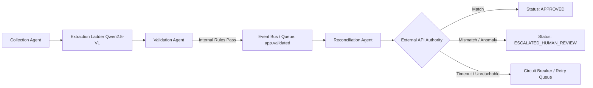

# Phase 5: Reconciliation Agent Architecture & Design Document

**Document Identifier:** DOCINTAKE-ARCH-PHASE5-RECON  
**Component:** Reconciliation Agent (Post-Intake Enterprise Integration)  
**Status:** Architecture Specification (Deliberately Out-of-Scope for Runtime Implementation)  
**Author:** AI Application Architect  

---

## 1. Scope & Objective

As established in Problem Statement Sections 5 and 10, the DocIntake system's primary scope ends once identity documents are collected, extracted via Qwen2.5-VL, validated across documents, and stored. 

This document defines the architectural blueprint for the **Phase 5 Reconciliation Agent**: an asynchronous, event-driven agent designed to cross-verify extracted document fields against authoritative external sources (e.g., National ID population registries, immigration databases, credit bureaus, or core banking backends).

---

## 2. Input Contract & Upstream Pipeline Integration

### 2.1 Upstream Handoff from Validation Agent (Phase 2)
The Reconciliation Agent is triggered immediately after the `ValidationAgent` marks an application as `READY_FOR_RECONCILIATION` or `COMPLETE` (internal validation passed).



### 2.2 Payload Schema
```json
{
  "event_id": "evt_rec_918273",
  "application_id": "app_20261116_001",
  "service_id": "premium_crossborder",
  "user_id": "usr_99182",
  "extracted_identity": {
    "full_name": "AHMED AL-RASHID",
    "date_of_birth": "1985-03-15",
    "document_type": "passport",
    "document_number": "P-9001",
    "issuing_country": "JO",
    "expiry_date": "2031-06-15"
  },
  "validation_metadata": {
    "internal_cross_match_score": 0.98,
    "vision_confidence": 0.94,
    "timestamp": "2026-11-16T08:40:00Z"
  }
}
```

---

## 3. External Verification & Decision Matrix

The agent queries the respective external registry adapter according to `service_id` and `issuing_country`:

| External Check Result | Meaning in Practice | System Action | Final Application State |
|:---|:---|:---|:---|
| **EXACT_MATCH** | All authoritative registry fields (Name, DOB, ID status) match extracted values within tolerance. ID is confirmed active/unrevoked. | Auto-approve identity verification. Generate audit signature. | `COMPLETE` / `APPROVED` |
| **NAME_PHONETIC_MATCH** | Minor spelling/transliteration variation (Arabic to English script) but Document Number and DOB match 100%. | Flag as low-risk review. Log discrepancy evidence. | `NEEDS_REVIEW` |
| **FIELD_MISMATCH** | Registry returns conflicting Date of Birth, or document is marked reported stolen/cancelled in external database. | Escalate immediately with high-priority fraud tag. Do not auto-reject without human sign-off. | `ESCALATED_HUMAN_REVIEW` |
| **UNVERIFIABLE** | External registry has no record for this document identifier (possible forged ID or unregistered document). | Route to specialist fraud investigation desk with detailed discrepancy report. | `ESCALATED_HUMAN_REVIEW` |
| **AUTHORITY_UNAVAILABLE** | External API timeout (>3.5s), HTTP 503, rate-limited, or TLS failure. | Route to exponential backoff retry queue; notify user of processing delay if retry window exceeds SLA. | `PENDING_EXTERNAL_VERIFY` |

---

## 4. Output Contract & Notification

The agent emits a structured reconciliation event and updates PostgreSQL via `ApplicationRepository`:

```json
{
  "reconciliation_id": "rec_res_00991",
  "application_id": "app_20261116_001",
  "decision": "MATCH",
  "confidence_score": 0.99,
  "registry_reference": "GOV-REG-AUTH-2026-8819",
  "plain_language_reason": "Identity verified with National Civil Registry. Document is active and unrevoked.",
  "escalate_to_human": false,
  "discrepancies": [],
  "audit_trail": {
    "latency_ms": 342,
    "authority_endpoint": "https://api.civilregistry.local/v2/verify",
    "verified_at": "2026-11-16T08:40:05Z"
  }
}
```

---

## 5. Resilience & Failure Modes

1. **Slow External Systems (Latency Spikes)**:
   - Dedicated Celery/Redis worker queue separates external I/O from the user-facing FastAPI thread pool.
   - Per-request timeout capped at 3,500ms.
2. **Registry Outage (Downtime)**:
   - Circuit breaker pattern (Netflix Hystrix / tenacity). After 5 consecutive connection timeouts, the circuit opens for 60 seconds.
   - Applications remain queued in `PENDING_EXTERNAL_VERIFY` without failing the user session.
3. **Flaky or Conflicting Upstream Data**:
   - If the external API returns ambiguous confidence (<0.70), the agent never makes an automated reject/accept decision; it compiles an escalation packet for human compliance officers.
